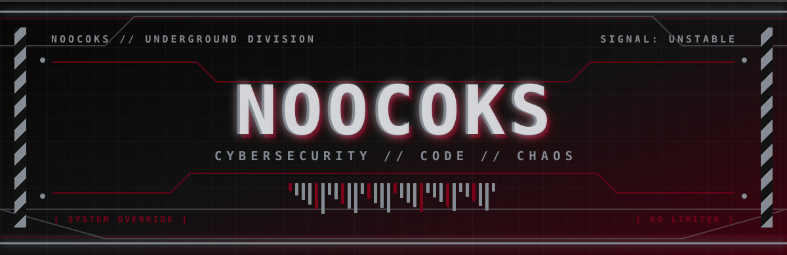

  

**Independent projects. Practical engineering. Security-minded development.**

*I learn by building: turning ideas, experiments and technical curiosity into useful software.*

  

## 01 / GITHUB ACTIVITY

  
  
   
  
  

### GITHUB TROPHIES

  

  

## 02 / SYSTEM PROFILE

| SECURITY | DEVELOPMENT | SYSTEMS | ENGINEERING |
|:---:|:---:|:---:|:---:|
| Secure-by-design thinking | Web & desktop applications | Linux & Windows environments | Automation & CI/CD |
| Practical security labs | Python, HTML, CSS & JavaScript | Docker & networking | Testing & maintainability |

My approach combines **security awareness**, **hands-on development** and **system-level curiosity**. I enjoy moving from understanding a problem to designing, building, testing and documenting a practical solution.

  

## 03 / PROFILE

I'm an independent developer focused on **cybersecurity, software development and systems**. I enjoy understanding how technology works beneath the surface, building tools that solve real problems and documenting what I learn along the way.

My work moves between web experiences, desktop applications, cross-platform experiments, automation and security-focused research. I value clear interfaces, maintainable architecture, practical testing and thoughtful details.

  

## 04 / SELECTED PROJECTS

  <table>
    <tr>
      <td width="50%" align="center" valign="middle">
        
      </td>
      <td width="50%" align="center" valign="middle">
        
      </td>
    </tr>
    <tr>
      <td width="50%" align="center" valign="middle">
        
      </td>
      <td width="50%" align="center" valign="middle">
        <!-- Add the next featured project here to extend the grid. -->
      </td>
    </tr>
  </table>

  SELECT A PROJECT TO EXPLORE ITS TECHNICAL CASE STUDY ↗

  

## 05 / TECHNICAL TOOLKIT

**DEVELOPMENT**

**SYSTEMS & WORKFLOW**

My current interests include secure application design, cross-platform development, interface engineering, automation, local AI and practical security labs.

  

## 06 / HOW I WORK

- **Build to understand.** I prefer practical experiments and working prototypes over theory alone.
- **Design for people.** Clear workflows and accessible interfaces matter as much as the underlying code.
- **Treat security as part of engineering.** Validate inputs, review dependencies, test boundaries and automate checks where possible.
- **Document the process.** Notes and repeatable procedures turn individual discoveries into reusable knowledge.
- **Keep improving.** Refactoring, responsive behaviour, accessibility and maintainability are ongoing work.

  

## 07 / CONNECT

Open to interesting ideas, technical conversations and collaboration.

  
   

  **BUILD WITH INTENT. KEEP EXPLORING. NEVER STOP REFINING.**

  NOOCOKS // Independent work in progress.

