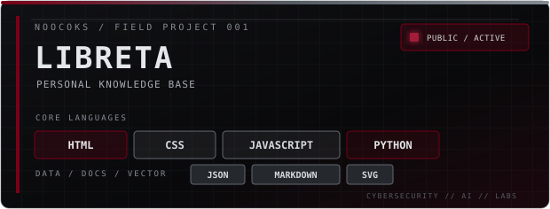

<div align="center">
  
</div>

<div align="center">
  
</div>

<div align="center">
  
</div>

<div align="center">
  <sub><code>[ SYSTEM ONLINE ]</code> HIGH VOLTAGE IDEAS · RAW CODE · CONTROLLED CHAOS · <code>[ NO SIGNAL LOST ]</code></sub>
</div>

<div align="center">
  
</div>

<!-- GitHub Trophies -->
<div align="center">
  
</div>

## <code>// 01 — GITHUB STATS</code>

<div align="center">
  <table>
    <tr>
      <td width="50%">
        
      </td>
      <td width="50%">
        
      </td>
    </tr>
  </table>

  
</div>

<div align="center">
  
</div>

## <code>// 02 — TECH ARSENAL</code>
<div align="center">
  <sub><code>01 / BUILD · DESIGN · AUTOMATE</code></sub>
</div>

**[ DEVELOPMENT CORE ]**

<div align="center">
  
</div>

<div align="center">
  <sub><code>02 / SYSTEMS · ENVIRONMENTS · WORKFLOW</code></sub>
</div>

**[ SYSTEMS & TOOLING ]**

<div align="center">
  
</div>

<div align="center">
  <sub><code>03 / TEST · BREAK · LEARN</code></sub>
</div>

**[ CURRENT EXPERIMENTS ]**

<div align="center">
  
  <br/>
  <sub>Exploring component-based interfaces, local AI workflows and modular CSS architecture.</sub>
</div>

<div align="center">
  
</div>

## <code>// 03 — SECURITY LAB</code>

I'm particularly interested in understanding how systems work, identifying vulnerabilities and learning how to secure them.

- 🔍 **Pentesting:** Learning offensive security techniques in controlled environments.
- 🌐 **Networking:** Understanding network protocols, services and infrastructure.
- 🕵️ **OSINT:** Information gathering and open-source intelligence.
- 🐧 **Linux:** Working with Linux environments and command-line tools.
- 🧪 **Labs:** Building local environments to experiment, document and learn.
- 🛡️ **Security:** Understanding vulnerabilities, defensive techniques and mitigation.
- 📚 **Technical documentation:** Developing Libreta, a personal knowledge base for tools, labs, procedures and development notes.

<sub>All security-related experiments are conducted in authorized environments and controlled labs.</sub>

<div align="center">
  
</div>

## <code>// 04 — OPERATOR PROFILE</code>

```python
class Noocoks:
    def __init__(self):
        self.name = "Noocoks"
        self.interests = [
            "Cybersecurity",
            "Software Development",
            "Linux & Open Source",
            "Local AI",
            "Technology"
        ]

        self.current_focus = [
            "Pentesting & Security Labs",
            "Frontend Development",
            "Python",
            "Scalable Software Architecture",
            "Local AI with Ollama",
            "Libreta: technical documentation & modular web architecture"
        ]

        self.mindset = "Learn by building"

    def say_hello(self):
        print("Always learning. Always building.")
        print("Nunca dejar de aprender.")

me = Noocoks()
me.say_hello()
```

### `// CURRENT OPERATIONS`

- 📚 Improving my cybersecurity knowledge through practical labs.
- 💻 Building and improving personal development projects.
- 🧠 Exploring local AI models and AI-assisted workflows.
- ⚙️ Learning better software architecture and development practices.
- 📝 Documenting what I learn along the way.

<div align="center">
  
</div>

## <code>// 05 — FIELD PROJECTS</code>

<div align="center">
  <a href="https://github.com/Noocoks/Libreta">
    
  </a>
</div>

**Libreta** — una base de conocimiento técnica en evolución continua: documentación de ciberseguridad, Android, IA, desarrollo y laboratorios locales. Construida con HTML, CSS y JavaScript, con estilos modulares y estadísticas de código automatizadas mediante GitHub Actions.

**More projects coming soon...**

<div align="center">
  
</div>

## <code>// 06 — SETUP</code>
<div align="center">
  <sub><code>HOST SYSTEM // DAILY ENVIRONMENT</code></sub>
  <br/><br/>
  
  
</div>

<div align="center">
  <sub><code>VIRTUALIZATION // ISOLATED LABS</code></sub>
  <br/><br/>
  
</div>

<div align="center">
  <sub><code>WORKBENCH // BUILD & SHIP</code></sub>
  <br/><br/>
  
  
  
</div>

<div align="center">
  <sub><code>ISOLATED LABS · LOCAL EXPERIMENTS · OPEN SOURCE</code></sub>
</div>

<div align="center">
  
</div>

## <code>// 07 — TRANSMISSION</code>
<div align="center">
  <sub><code>SECURE CHANNEL // PICK YOUR ROUTE</code></sub>
  <br/><br/>
  <a href="https://github.com/Noocoks">
    
  </a>
  &nbsp;
  <a href="mailto:nicoletobondia06@gmail.com">
    
  </a>
  <br/><br/>
  <code>nicoletobondia06@gmail.com</code>
  <br/>
  <sub>Ideas, collaboration or just a good conversation. Channel open.</sub>
</div>

<div align="center">
  
</div>

<div align="center">

### `root@noocoks:~$ ./init-chaos.sh`

**NO COMFORT ZONE. JUST CONSTANT EVOLUTION.**

*Construyendo. Experimentando. Rompiendo límites (en laboratorio).*


</div>
