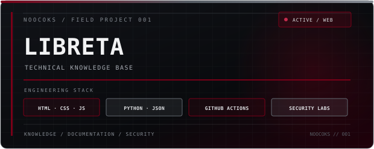

<div align="center">
  
</div>

<div align="center">
  
</div>

<div align="center">
  
</div>

<div align="center">
  <sub><code>[ SYSTEM ONLINE ]</code> HIGH VOLTAGE IDEAS · RAW CODE · CONTROLLED CHAOS · <code>[ NO SIGNAL LOST ]</code></sub>
</div>

<div align="center">
  
</div>

<div align="center">
  
</div>

## <code>// 01 — GITHUB STATS</code>

<div align="center">
  <table>
    <tr>
      <td width="50%">
        
      </td>
      <td width="50%">
        
      </td>
    </tr>
  </table>
  
</div>

<div align="center">
  
</div>

## <code>// 02 — TECH ARSENAL</code>

<div align="center">
  <sub><code>01 / BUILD · DESIGN · AUTOMATE</code></sub>
  <br/><br/>
  
</div>

<div align="center">
  <sub><code>02 / SYSTEMS · ENVIRONMENTS · WORKFLOW</code></sub>
  <br/><br/>
  
</div>

<div align="center">
  <sub><code>03 / CURRENT EXPLORATION</code></sub>
  <br/><br/>
  
  <br/>
  <sub>Local AI, cross-platform applications, interface engineering and secure software architecture.</sub>
</div>

<div align="center">
  
</div>

## <code>// 03 — SECURITY LAB</code>

I'm interested in understanding how systems work, identifying weaknesses and learning how to secure them through practical work.

- 🔍 **Pentesting:** Offensive security techniques in authorized environments.
- 🌐 **Networking:** Protocols, services and infrastructure.
- 🕵️ **OSINT:** Open-source intelligence and information gathering.
- 🐧 **Linux:** System administration and command-line tooling.
- 🧪 **Labs:** Local environments for testing, documenting and learning.
- 🛡️ **Secure development:** Input validation, safer session handling, dependency auditing and automated checks.
- 📚 **Knowledge sharing:** Libreta, my evolving technical knowledge base.

<sub>All security-related experiments are conducted in authorized environments and controlled labs.</sub>

<div align="center">
  
</div>

## <code>// 04 — OPERATOR PROFILE</code>

```python
class Noocoks:
    def __init__(self):
        self.name = "Noocoks"
        self.interests = [
            "Cybersecurity",
            "Software Development",
            "Linux & Open Source",
            "Local AI",
            "Creative Technology"
        ]
        self.current_focus = [
            "Security research & practical labs",
            "Cross-platform application development",
            "Frontend engineering & interaction design",
            "Python automation",
            "Local AI workflows",
            "Secure software architecture"
        ]
        self.mindset = "Learn by building"

    def say_hello(self):
        print("Always learning. Always building.")
        print("Nunca dejar de aprender.")

me = Noocoks()
me.say_hello()
```

### `// CURRENT OPERATIONS`

- 🛠️ Building and maintaining independent software projects.
- 🔐 Improving application security and development workflows.
- 🎨 Refining responsive interfaces, animations and visual identities.
- 🧠 Exploring local AI and practical automation.
- 📝 Turning experiments and research into reusable documentation.

<div align="center">
  
</div>

## <code>// 05 — FIELD PROJECTS</code>

A selection of projects I'm actively building and maintaining.

<div align="center">
  <a href="https://github.com/Noocoks/Libreta">
    
  </a>
</div>

**[Libreta](https://github.com/Noocoks/Libreta)** · [Live website](https://noocoks.github.io/Libreta/)

A modular technical knowledge base covering cybersecurity, Android, AI, development and controlled labs. Includes a responsive wiki, structured navigation, modular CSS, automated project metrics and GitHub Actions quality checks.

---

<div align="center">
  <a href="https://github.com/Noocoks/SOUNWD">
    
  </a>
</div>

**[SOUNWD](https://github.com/Noocoks/SOUNWD)**

A cross-platform audio downloader for Windows and Linux, with an Android version in development. Built around a simple GUI, yt-dlp, configurable formats and advanced options. Uses one master brand asset to generate platform icons and automated CI builds.

---

<div align="center">
  <a href="https://github.com/Noocoks/OpenLiveVideo">
    
  </a>
</div>

**[OLV — Open Live Video](https://github.com/Noocoks/OpenLiveVideo)**

A desktop application for creating vertical YouTube Shorts locally on Windows and Linux. Turns a written story into a reviewed sequence of scenes, voice narration, subtitles and a 1080×1920 MP4 using Pixabay, Edge TTS and FFmpeg. Publishing always stays under manual control.

---

<div align="center">
  <a href="https://github.com/Noocoks/Pf">
    
  </a>
</div>

**[Personal Portfolio](https://github.com/Noocoks/Pf)** · [Visit website](https://noocoks.github.io/Pf/)

My personal portfolio: a responsive showcase of my profile, projects and work across development, systems and technology. Features a custom visual identity, smooth scrolling, section-based background transitions and refined motion.

<div align="center">
  <sub><code>MORE EXPERIMENTS · MORE BUILDS · ALWAYS EVOLVING</code></sub>
</div>

<div align="center">
  
</div>

## <code>// 06 — SETUP</code>

<div align="center">
  <sub><code>HOST SYSTEM // DAILY ENVIRONMENT</code></sub>
  <br/><br/>
  
  
</div>

<div align="center">
  <sub><code>VIRTUALIZATION // ISOLATED LABS</code></sub>
  <br/><br/>
  
</div>

<div align="center">
  <sub><code>WORKBENCH // BUILD & SHIP</code></sub>
  <br/><br/>
  
  
  
</div>

<div align="center">
  <sub><code>ISOLATED LABS · LOCAL EXPERIMENTS · OPEN SOURCE</code></sub>
</div>

<div align="center">
  
</div>

## <code>// 07 — TRANSMISSION</code>

<div align="center">
  <sub><code>SECURE CHANNEL // PICK YOUR ROUTE</code></sub>
  <br/><br/>
  <a href="https://github.com/Noocoks">
    
  </a>
  &nbsp;
  <a href="mailto:nicoletobondia06@gmail.com">
    
  </a>
  <br/><br/>
  <code>nicoletobondia06@gmail.com</code>
  <br/>
  <sub>Ideas, collaboration or just a good conversation. Channel open.</sub>
</div>

<div align="center">
  
</div>

<div align="center">

### `root@noocoks:~$ ./init-chaos.sh`

**NO COMFORT ZONE. JUST CONSTANT EVOLUTION.**

*Construyendo. Experimentando. Rompiendo límites (en laboratorio).*


</div>
